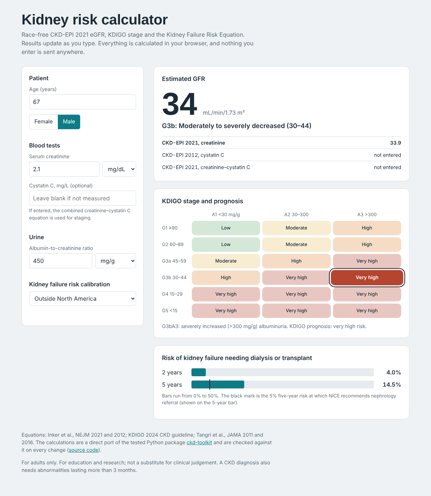

# Kidney Risk Calculator (web)


**Live:** https://alirezajavan-sys.github.io/kidney-risk-calculator/

A free, browser-based calculator for adults with (suspected) chronic kidney disease. It gives:

* **eGFR**: race-free CKD-EPI 2021 (creatinine, or creatinine–cystatin C), plus CKD-EPI 2012 cystatin C;
* **KDIGO stage**: G and A categories, with the patient's cell highlighted on the KDIGO prognosis heat map;
* **Kidney failure risk**: the 4-variable Kidney Failure Risk Equation (KFRE) at 2 and 5 years, with the 5% referral
  threshold marked.

<p align="center"></p>

## Design principles

* **Private by construction.** Everything runs in the browser. No server, no analytics, no cookies, and no data
  leaves the device.
* **One source of truth.** `calc.js` is a line-by-line port of the Python package
  [ckd-toolkit](https://github.com/alirezajavan-sys/ckd-toolkit). A parity test checks **600 reference cases**
  generated by the Python package to a tolerance of 1e-9 on every commit. These cover eGFR across ages, sexes and
  creatinine/cystatin values; KFRE for both calibrations; and every KDIGO boundary. The web and Python versions
  cannot silently drift apart.
* **Clinically honest.** The page warns when KFRE is applied outside its validated range (eGFR ≥ 60), rejects ages
  under 18, and supports SI units (µmol/L, mg/mmol). KFRE defaults to the non-North American calibration, with a
  switch for the US and Canada.
* **Accessible.** It is keyboard-operable with visible focus, all text passes WCAG AA contrast, it respects
  reduced-motion preferences, and it works on phones.

## Run locally

No build step and no dependencies:

```bash
git clone https://github.com/alirezajavan-sys/kidney-risk-calculator.git
cd kidney-risk-calculator
python3 -m http.server 8000      # then open http://localhost:8000
npm test                          # parity tests (Node 18+)
```

To regenerate the reference values from the Python package:

```bash
pip install git+https://github.com/alirezajavan-sys/ckd-toolkit.git
python scripts/make_reference.py
```

## Files

```
├── index.html                 # the calculator (HTML + CSS + UI script)
├── calc.js                    # equations: ES module, shared by the page and the tests
├── test/parity.test.mjs       # node:test parity suite
├── test/reference_values.json # 600 cases generated by ckdtools
└── scripts/make_reference.py  # regenerates the reference values
```

## References

* Inker LA, et al. New creatinine- and cystatin C–based equations to estimate GFR without race. *N Engl J Med.*
  2021;385:1737–49.
* Inker LA, et al. Estimating glomerular filtration rate from serum creatinine and cystatin C. *N Engl J Med.*
  2012;367:20–9.
* KDIGO 2024 Clinical Practice Guideline for the Evaluation and Management of CKD. *Kidney Int.* 2024;105(4S):S117–S314.
* Tangri N, et al. A predictive model for progression of chronic kidney disease to kidney failure. *JAMA.*
  2011;305:1553–9.
* Tangri N, et al. Multinational assessment of accuracy of equations for predicting risk of kidney failure.
  *JAMA.* 2016;315:164–74.

> For education and research. Not a medical device and not a substitute for clinical judgement.

## Author

**Alireza Javan**. [GitHub profile](https://github.com/alirezajavan-sys)
